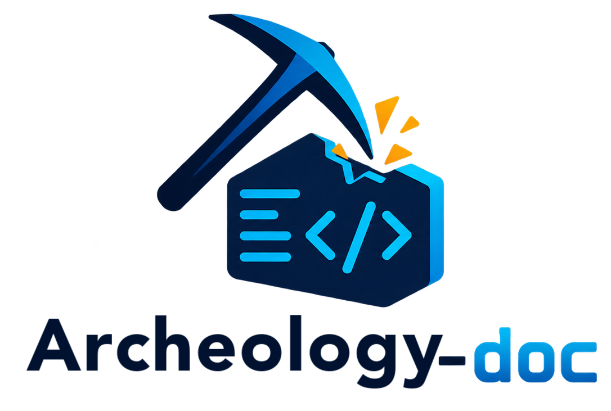

# archeology-doc

<picture>
  <source media="(prefers-color-scheme: dark)" srcset="assets/logo-dark.png">
  
</picture>

CLI escrito en Rust que inspecciona proyectos de software — nuevos o legacy, pequeños o grandes — y genera:

- una **base de conocimiento en Markdown** navegable con Obsidian (`knowledge/`),
- **documentación con VitePress** (`docs/`, manual de usuario, guías, referencia),
- **contexto y memoria para agentes de IA** (`AGENTS.md`, `knowledge/memory/`),
- **integración con OpenSpec**: cruza specs ↔ código y detecta desfases,
- un **registro global** de los proyectos en los que trabajas (`~/.archeology-doc/`).

La investigación la realizan los agentes que ya usas (Claude Code, Codex, OpenCode, Devin…); archeology-doc orquesta, estructura y valida.

## Instalación

Binario precompilado (sin Rust), desde el sitio publicado:

```bash
curl -fsSL https://archeology-doc.com/download/install.sh | sh          # macOS / Linux
irm https://archeology-doc.com/download/install.ps1 | iex                # Windows (PowerShell)
```

Desde el código (instaladores y build de descargas en [WEBSITE/](WEBSITE/README.md)):

```bash
WEBSITE/installers/install.sh  # compila este clon con cargo
cargo install --path crates/archeology-cli
# o desde el repo:
cargo build --release
# binarios en target/release/: `adoc` (corto) y `archeology-doc` (equivalente)

adoc doctor                    # verifica git, Node, VitePress, OpenSpec y agentes
adoc site setup                # opcional: VitePress compartido para todos los proyectos
```

Actualizar: vuelve a ejecutar el instalador con el que lo instalaste (`curl … | sh`, `irm … | iex`
o `WEBSITE/installers/install.sh` desde un clon actualizado con `git pull`); reemplaza los binarios.
`cargo install --path crates/archeology-cli --force` solo sirve desde un clon del repositorio.

Desinstalar:

```bash
adoc uninstall                 # quita los binarios `adoc` y `archeology-doc`
adoc uninstall --purge         # además borra ~/.archeology-doc (registro, estado, aprobaciones, VitePress)
```

Los proyectos no se tocan: `archeology-doc.toml`, `knowledge/`, `docs/` y las regiones de `AGENTS.md`
quedan en cada repositorio. Si se instaló con `cargo install`, usa `cargo uninstall archeology-cli`.

## Uso rápido

```bash
cd mi-proyecto-legacy

adoc init            # crea archeology-doc.toml + estructura
adoc scan            # inventario determinista → inventory.json + knowledge/00-overview.md
adoc plan            # genera tareas acotadas en ~/.archeology-doc/projects/<proyecto>/tasks/
adoc inspect         # ejecuta con el agente configurado (o exporta en modo manual)
adoc review          # resumen: hallazgos, tests, progreso
adoc check           # validaciones para CI (frontmatter, evidencias, enlaces)
```

Modo manual (agentes sin headless, p. ej. Devin/Cursor):

```bash
adoc inspect --agent manual     # exporta prompts
# …ejecuta cada tarea (`adoc task show T-001`) con tu agente…
adoc task done T-001            # marca completada tras revisar la salida
```

Trabajar desde otro directorio:

```bash
adoc projects list
adoc review --project mi-proyecto
adoc resume                     # retoma la inspección pendiente
```

## Dónde queda cada cosa

```
mi-proyecto/                          # solo configuración y resultados
├── archeology-doc.toml               # config + ID del proyecto (versionable)
├── knowledge/  docs/  llms.txt       # vault Obsidian, sitio VitePress
└── AGENTS.md  CLAUDE.md  .agents/    # contexto para agentes (regiones gestionadas)

~/.archeology-doc/                    # estado de trabajo, fuera del repositorio
├── registry.toml                     # índice de proyectos
├── vitepress/                        # VitePress compartido (`adoc site setup`)
└── projects/<nombre>-<id8>/          # por proyecto
    ├── state.json  inventory.json
    ├── tasks/                        # T-*.md
    └── runs/<fecha>-<id>/            # run.log y un log por tarea
```

Los proyectos con el estado antiguo dentro del repositorio (`<proyecto>/.archeology-doc/` o, con el
nombre anterior, `<proyecto>/.arqueology-doc/`) se migran solos al primer comando, y el registro de
`~/Library/Application Support/archeology-doc` o `~/Library/Application Support/arqueology-doc`
(o sus equivalentes en `~/.config/…`) también.

## Agentes

```bash
adoc agent list                       # disponibles; * = activo
adoc agent use claude --model opus    # cambia el agente y el modelo del proyecto
adoc agent use devin                  # Devin CLI
adoc agent use manual                 # sin agente: exporta tareas para hacerlas a mano
adoc agent use devin --reset          # vuelve a la definición predefinida del adaptador
adoc inspect --agent codex --model gpt-5   # solo para esta corrida
```

Agentes predefinidos (modo no interactivo con permiso de escritura):

| Agente | Comando |
|--------|---------|
| `claude` | `claude -p --permission-mode acceptEdits` (tarea por stdin) |
| `codex` | `codex exec -s workspace-write -` (stdin) |
| `devin` | `devin -p --permission-mode smart --respect-workspace-trust false --prompt-file <tarea>` |
| `gemini` | `gemini --approval-mode auto_edit` (stdin) |
| `qwen` | `qwen --approval-mode auto-edit` (stdin) |
| `opencode` | `opencode run <tarea>` |
| `cursor` | `agent -p --force --output-format text <tarea>` |
| `copilot` | `copilot -p <tarea> --allow-all-tools` |
| `amp` | `amp --dangerously-allow-all -x <tarea>` |
| `goose` | `goose run -i -` (stdin) |
| `aider` | `aider --message-file <tarea> --yes-always --no-auto-commits` |
| `manual` | exporta las tareas para hacerlas a mano |

Los flags de cada CLI cambian con el tiempo: `adoc agent test` y `adoc doctor` los comprueban, y cualquier
adaptador se puede redefinir en `[agent.adapters.<nombre>]`.

**Seguridad.** `archeology-doc.toml` viaja con el repositorio y puede venir de terceros, así que un
adaptador que no sea idéntico a uno predefinido no se ejecuta (ni siquiera `--version`) hasta que lo
revisas y lo apruebas:

```bash
adoc agent trust mi-agente     # muestra command, args y env, y pide confirmación
adoc agent untrust mi-agente   # retira la aprobación
```

La aprobación se guarda en `~/.archeology-doc/trusted-adapters.toml`, ligada al proyecto y a la
definición exacta: si el adaptador cambia en el repositorio, hay que volver a aprobarlo. Los
adaptadores `copilot`, `amp`, `aider`, `cursor` y `devin` (`--respect-workspace-trust false`) corren
sin confirmaciones (pueden ejecutar comandos de shell): `inspect` lo avisa. Úsalos solo con repositorios de confianza. `adoc preview` y
`adoc site` ejecutan la configuración de VitePress del proyecto (JavaScript): la primera vez en cada
proyecto piden confirmación (se recuerda en `trusted-adapters.toml`). Sin terminal interactiva, como en CI,
hay que aprobarlo con `--yes` (`adoc preview --yes`, `adoc site build --yes`, `adoc check --site --yes`).

`agent use` edita `archeology-doc.toml` conservando su formato. Con `manual`, `inspect` marca
las tareas como manuales; se ejecutan en esa herramienta y se cierran con `adoc task done <id>`.
Al cambiar a un agente con CLI, las tareas manuales sin completar vuelven a `pending` y basta `adoc inspect`;
las tareas `done` nunca se tocan.

## Comandos

| Comando | Descripción |
|---------|-------------|
| `init` | Inicializa config y estructura (`--yes`, `--agent`, `--lang`, `--name`, `--adapters claude,cursor,copilot`) |
| `scan` | Inventario determinista; actualiza `00-overview.md`, `AGENTS.md`, adaptadores, skills e índices (`--no-git`, `--json`) |
| `plan` | Genera/actualiza tareas priorizadas (`--module`, `--type`, `--path`, `--force`) |
| `inspect` | Ejecuta tareas con agente en orden de dependencias (`--agent`, `--model`, `--task`, `--module`, `--resume`, `--dry-run`) |
| `task list/show/export/done` | Gestión de tareas en modo manual (`done` valida la salida; `--force` la omite) |
| `task answer <id> "<texto>"` | Responde la pregunta de un agente y deja la tarea lista para reintentar |
| `task run <id>` | Ejecuta una sola tarea (`--interactive` abre la sesión del agente; `--agent`, `--model`) |
| `review` | Progreso, hallazgos, funcionalidades sin tests, cumplimiento de specs y resumen del grafo (`--severity`, `--format text\|json\|markdown`) |
| `check` | Validaciones para CI: frontmatter, evidencias (archivo y líneas), wikilinks, IDs, duplicados, notas stale (`--strict`, `--format`, `--site`) |
| `sync` | Marca `stale` las notas cuyas fuentes cambiaron y reabre sus tareas (`--since <ref>`, `--dry-run`) |
| `site setup` | Instala VitePress en el directorio de configuración, compartido por todos los proyectos (`--version`) |
| `site sync/dev/build` | Copia vault y specs a `docs/`, genera sidebar y `llms.txt`; `dev`/`build` delegan en VitePress |
| `status` | Estado completo del proyecto en JSON (usado por la extensión) |
| `preview` | Sitio con dashboard en el navegador; sin VitePress, el reporte HTML (`--port`, `--no-open`) |
| `report` | Reporte HTML único o Markdown (`--format`, `--out`, `--no-open`) |
| `graph` | Grafo del conocimiento: JSON (vista de la extensión), resumen en texto o HTML interactivo (`--format json\|text\|html`, `--out`, `--open`) |
| `ask "<pregunta>"` | Pregunta al agente; la respuesta queda en la FAQ (`--agent`, `--model`) |
| `doctor` | Verifica requisitos del CLI y del proyecto; código 1 si falta algo obligatorio (`--format`) |
| `agent list/test` | Lista y prueba adaptadores; `*` marca el activo |
| `agent use <agente>` | Cambia el agente activo del proyecto, p. ej. `claude` o `devin` (`--model`, `--no-model`, `--reset`) |
| `spec status` | Cumplimiento de requisitos de OpenSpec y cambios abandonados (`--capability`, `--format`) |
| `spec baseline` | Prepara un cambio `baseline-<fecha>` y la tarea para inferir specs base (`--capability`, `--dry-run`) |
| `spec validate <cambio>` | Valida un cambio con `openspec validate --strict` o validación estructural |
| `projects list/add/discover/prune` | Registro global con progreso, hallazgos y cumplimiento (`--format`) |
| `resume [proyecto]` | Retoma la última inspección pendiente |

Opción global: `--project <nombre|id>` en todos los comandos.

## Cómo funciona una tarea

1. `plan` escribe las tareas `T-*.md` en el espacio de trabajo con objetivo, archivos a leer, salidas (`# Produce`) y reglas.
2. `inspect` ejecuta cada tarea cuando sus dependencias están `done`. Una tarea solo queda `done` si el agente
   termina con código 0 **y** produjo lo declarado con frontmatter y evidencias válidas; si no, queda `failed`
   y sus dependientes, bloqueadas. Los reintentos se configuran en `agent.retries` (máximo 10).
   Con Ctrl+C, `inspect` detiene al agente y a sus subprocesos, deja la tarea en curso en `pending`
   y sale con código 130; `adoc resume` la retoma.
3. Cada corrida deja `runs/<fecha>-<id>/run.log` y un log por tarea; en repos git avisa si el agente
   modificó archivos fuera de las rutas permitidas.
4. `sync` vuelve `stale` las notas cuyas fuentes cambiaron (salvo `locked: true`) y reabre sus tareas.

## Tamaño del proyecto

`plan` ajusta cuántas tareas genera según los archivos de **código** (no cuenta docs, datos, imágenes ni
videos; las carpetas ocultas de herramientas como `.devin` o `.vscode` no son módulos):

| Perfil | Archivos de código | Tareas por grupo de módulos | Ejemplo |
|--------|--------------------|-----------------------------|---------|
| `small` | ≤ 150 | 1 (módulos + funcionalidades + tests) | ~45 archivos → 6-7 tareas |
| `medium` | ≤ 1500 | 2 (módulos + funcionalidades, tests) | |
| `large` | > 1500 | 3 (módulos, funcionalidades, tests) | |

Los módulos vecinos se agrupan en una misma tarea hasta `max_files_per_task` / `max_bytes_per_task`.
El perfil es automático (`[plan] size = "auto"`) o fijo (`"small"`, `"medium"`, `"large"`). Si el plan
cambia, `adoc plan --force` lo reemplaza: borra las tareas que sobran y las que no cambian conservan su estado.

## Ver el resultado

```bash
adoc preview            # sitio VitePress con dashboard, abierto en el navegador
adoc report             # reporte HTML único (sin Node), se puede compartir
adoc report --out informe.html --no-open
adoc ask "¿Cómo se calcula el total de una reserva?"   # pregunta al agente → FAQ
```

- **`preview`** prepara el sitio (`site sync`) y lo abre con `vitepress dev --open`. La portada incluye un
  resumen (región gestionada `dashboard` en `docs/index.md`) y el sidebar añade **Estado**, **Hallazgos** y
  **Preguntas y FAQ** y **Grafo del conocimiento**. Sin VitePress, muestra el reporte HTML.
- **`report`** genera un HTML autocontenido (sin CDN ni recursos externos) en el espacio de trabajo, con
  progreso, hallazgos por severidad y evidencias, funcionalidades sin tests, specs, el grafo del
  conocimiento, tareas y preguntas. `--format markdown` incluye el resumen del grafo.
- **Preguntas**: las del agente que bloquean tareas (`task answer`), las dudas para el equipo técnico que los
  agentes registran en `knowledge/memory/open-questions.md`, y la **FAQ**: respuestas de `adoc ask`
  (notas `type: faq` en `knowledge/faq/`) y las dadas con `task answer`.

## Grafo del conocimiento

Las notas del vault y sus relaciones, como el grafo de Obsidian: wikilinks, `related` (hallazgos),
`modules`, tests de cada funcionalidad y el código citado como evidencia (`sources`).

```bash
adoc graph --open                 # HTML interactivo en el espacio de trabajo, abierto en el navegador
adoc graph --format html --out grafo.html
adoc graph --format text          # conteos
adoc graph                        # JSON (lo usa la extensión)
```

- **Dónde se ve**: la página HTML de `graph --open` (`~/.archeology-doc/projects/<proyecto>/graph.html`),
  la sección **Grafo** de `adoc report`, la página **Grafo del conocimiento** del sitio (`docs/grafo.md`,
  enlazada desde la portada y el sidebar; `site sync` la regenera) y la pestaña **Grafo** de la extensión.
  Los cuatro usan el mismo renderizador (`crates/archeology-core/assets/graph.js`, sin dependencias).
- **Interacción**: búsqueda (Enter centra la primera coincidencia), filtro por tipo en la leyenda (índices
  y código ocultos al empezar), zoom con la rueda o `+`/`−`, arrastrar para mover nodos o la vista. Un clic
  abre la nota: en el sitio navega a su página del vault; en el HTML y el reporte muestra título, tipo y
  ruta con enlace `file://`; en la extensión abre el archivo en el editor (el código, en la línea citada).
- **Resumen** (`adoc review`, en texto, markdown y la clave `graph` del JSON): notas, archivos de código,
  relaciones por tipo, las 5 notas más conectadas y las **notas huérfanas** (sin ninguna relación; no
  cuentan los índices/MOCs).
- **Seguridad**: el HTML no carga nada externo y lleva una CSP con nonce; los datos van como JSON escapado
  (un título con `</script>` no rompe la página). El sitio no publica rutas absolutas locales; sus recursos
  van en `docs/public/adoc-graph/` (marcada como generada: si existe sin la marca, `site sync` no la toca).
- Textos: la página de `graph --open` y el resumen de `review` usan el idioma de la interfaz; el reporte y
  el sitio, el de la documentación del proyecto.

## Cuando el agente pregunta

Los agentes corren sin interfaz, así que nadie puede contestarles en el momento:

1. **Cada tarea les indica no preguntar**: deciden lo más razonable, lo marcan `confidence: low` y anotan la
   duda en `knowledge/memory/open-questions.md`.
2. **Si aun así terminan con una pregunta**, la tarea queda en estado `question` (no se reintenta en vano):
   ```
   ? T-014 pregunta: ¿El descuento máximo correcto es 10 % o 20 %?
     responde con: adoc task answer T-014 "<respuesta>"
   ```
   `task answer` guarda la respuesta en la sección `# Respuestas` de la tarea y la vuelve a `pending`; el
   siguiente `adoc inspect` la ejecuta con esa información. Las tareas que no dependen de ella siguen.
3. **Para tareas complejas**, `adoc task run T-014 --interactive` abre la sesión normal del agente con la
   tarea como primer mensaje; al salir, `adoc` valida la salida y la marca `done`. Disponible para claude,
   codex, devin, gemini, qwen y cursor (`interactive_args` en la config para otros).

## Sitio

VitePress (Node 18+) se busca en este orden:

1. **Proyecto**: `node_modules/vitepress` (`npm i -D vitepress`).
2. **Compartido**: `adoc site setup` lo instala una vez en el directorio de configuración.
3. **Global**: `npm i -g vitepress`.

Con 2 y 3, `site dev|build` enlaza `docs/node_modules` a esa instalación (ignorado en `docs/.gitignore`),
sin tocar el `package.json` del proyecto. En Windows el enlace requiere el modo desarrollador; si no,
usa la opción 1. `adoc doctor` muestra cuál se usará. Para verificar en CI: `adoc check --site --yes`.

## Idioma / Language

`adoc` habla inglés (`en`) y español (`es`). Hay dos idiomas independientes:

**Idioma de la interfaz** (mensajes, errores, avisos). Se elige, de mayor a menor prioridad:

1. el flag global `--lang <en|es>`;
2. la variable de entorno `ADOC_LANG`;
3. `language` en `~/.archeology-doc/config.toml` (o `$ARCHEOLOGY_DOC_CONFIG_DIR/config.toml`);
4. el locale del sistema (`LC_ALL`, `LC_MESSAGES`, `LANG` o el del sistema operativo: `es*` → `es`, `en*` → `en`);
5. `en`.

Un valor inválido se avisa y se pasa a la siguiente fuente.

```bash
adoc config set language es   # guarda la preferencia
adoc config get language      # valor efectivo y su origen (--json para scripts)
adoc config unset language    # vuelve a la detección automática
```

**Idioma de la documentación del proyecto**: el del contenido generado (plantillas, regiones de
`AGENTS.md`/`CLAUDE.md`, notas índice, `llms.txt`, sitio y prompts de las tareas; se le indica al agente
en qué idioma escribir las notas). Se guarda en `archeology-doc.toml`:

```toml
[project]
language = "en"   # en | es
```

`adoc init --lang <en|es>` lo fija; sin `--lang`, se usa el idioma de la interfaz resuelto. Las
configuraciones sin el campo (anteriores a esta versión) se tratan como `es`. La salida para máquinas
(claves JSON, estados como `pending`/`done`/`question`, claves de frontmatter y nombres de archivo) no
cambia con el idioma.

## Variables de entorno

| Variable | Uso |
|----------|-----|
| `ARCHEOLOGY_DOC_CONFIG_DIR` | Directorio de configuración (por defecto `~/.archeology-doc`). Útil en tests y CI. |
| `ADOC_LANG` | Idioma de la interfaz (`en`, `es`); ver [Idioma / Language](#idioma--language). |
| `RUST_LOG` | Filtro de logs (`-v`/`-vv` equivalen a `info`/`debug`). |

## Extensión de VS Code

`extension/` contiene una interfaz visual sobre el CLI: panel con tareas (ejecutar, interactivo, responder
preguntas), hallazgos con salto a la evidencia, conocimiento por tipo y specs; barra de estado con progreso
y agente; marcas en el editor en las líneas citadas por hallazgos. Ver [extension/README.md](extension/README.md).

Al iniciar comprueba las herramientas: si falta `adoc` ofrece instalarlo (ejecuta el instalador oficial en
un terminal visible y verifica el SHA-256), y si faltan git, Node o VitePress ofrece instalarlos o enlaza su
descarga. Nada se instala sin un clic. Comando: *adoc: Instalar herramientas*; se desactiva con
`archeologyDoc.checkToolsOnStartup`.

```bash
cd extension && npm ci && npm run package
code --install-extension archeology-doc-0.1.0.vsix
```

## Estructura del repo

```
crates/
  archeology-core/      # modelos, estado, plantillas, validación
  archeology-scan/      # scanner e inventario
  archeology-agents/    # orquestador y adaptadores
  archeology-openspec/  # spec bridge
  archeology-registry/  # registro global
  archeology-cli/       # binario
templates/{en,es}/      # plantillas de notas, tareas y sitio, por idioma
crates/archeology-core/assets/           # renderizador del grafo (graph.js/.css), copia única
crates/archeology-core/locales/{en,es}/  # catálogos de mensajes (i18n)
fixtures/               # repos de prueba: small-node, medium-ts, legacy-py, with-openspec
```

## Desarrollo

```bash
cargo build
cargo test --workspace
cargo clippy --workspace --all-targets -- -D warnings
# build real del sitio (instala VitePress en un directorio temporal; requiere Node y red):
cargo test -- --ignored
```

## Licencia

MIT — ver [LICENSE-MIT](LICENSE-MIT).
